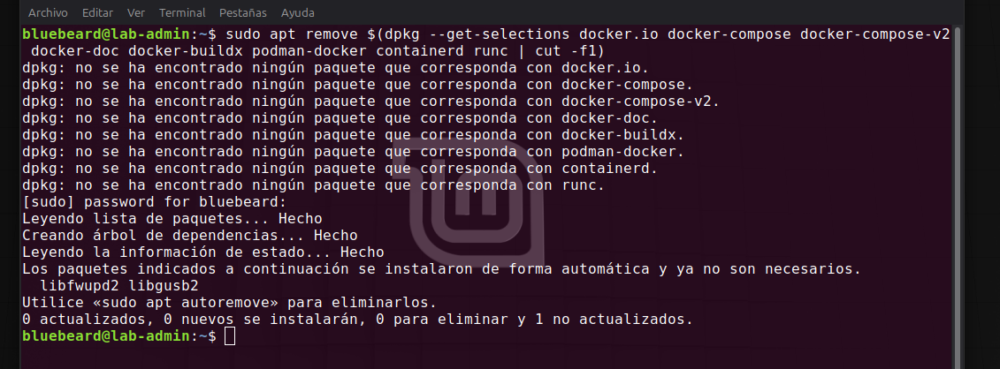
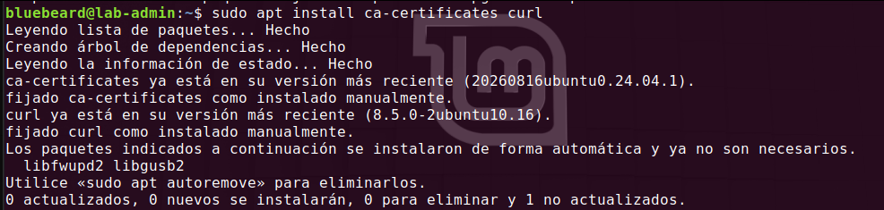
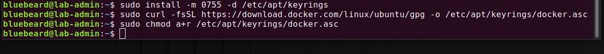
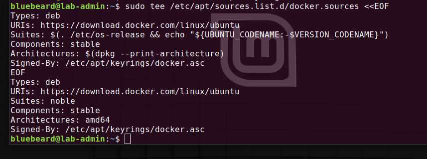
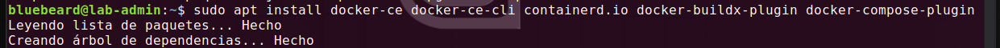

## 1. Instalación Segura desde el Repositorio Oficial (GPG)

Para garantizar la integridad y la actualización constante del motor de contenedores ante posibles vulnerabilidades de día cero (*Zero-Days*), evitamos el uso de los paquetes genéricos de los repositorios de Ubuntu. En su lugar, configuramos de forma segura la fuente oficial de Docker mediante la verificación de firmas criptográficas GPG.

### Comandos ejecutados en el Laboratorio:

#### Paso 1: Purga y Remoción de Paquetes Conflictivos Anteriores
Como primera medida de hardening, es indispensable asegurar que el sistema operativo no cuente con versiones de Docker obsoletas, paquetes genéricos de la distribución (`docker.io`) o empaquetados en formato Snap/Flatpak. Esto previene conflictos en la gestión de binarios y elimina dependencias desactualizadas que podrían contener fallas de seguridad explotables.

Ejecutamos el comando de remoción masiva en el servidor:

```bash
sudo apt remove $(dpkg --get-selections docker.io docker-compose docker-compose-v2 docker-doc docker-buildx podman-docker containerd runc | cut -f1)
```

<br>

<br>


#### Paso 2: Actualizar los índices del sistema y validar dependencias previas
Preparamos el gestor de paquetes `apt` para asegurar que pueda comunicarse a través de protocolos seguros HTTPS y manejar certificados de confianza:

```bash
sudo apt update
sudo apt install ca-certificates curl
```

<br>

<br>

*Nota de laboratorio: En mi caso, como se observa en la consola, el gestor de paquetes verificó el sistema y determinó que ambos componentes ya se encuentran instalados de fábrica en su versión más reciente, dejando el entorno listo y asegurado para el siguiente paso.*

#### Paso 3: Creación de Directorio Seguro y Descarga de la Llave Criptográfica Oficial
Para que el gestor de paquetes confíe en el repositorio de Docker, debemos descargar su firma digital legítima. Siguiendo las mejores prácticas actuales de Debian/Ubuntu, almacenamos esta llave en un directorio aislado y restringido de confianza (`keyrings`).

Ejecutamos la secuencia para generar la ruta y descargar el certificado oficial:

```bash
sudo install -m 0755 -d /etc/apt/keyrings
sudo curl -fsSL https://download.docker.com/linux/ubuntu/gpg -o /etc/apt/keyrings/docker.asc
sudo chmod a+r /etc/apt/keyrings/docker.asc
```

<br>

<br>

**Análisis de Hardening Aplicado:**
*   **`install -m 0755 -d`**: A diferencia de un `mkdir` común, este comando crea la carpeta `/etc/apt/keyrings` y le clava de forma explícita los permisos seguros `755` (Lectura, escritura y ejecución para root; lectura y entrada para el resto), garantizando que ningún usuario común pueda modificar su contenido.
*   **`docker.asc`**: Es la llave criptográfica oficial en formato de texto claro firmado.
*   **`chmod a+r`**: Le otorga permisos de lectura a todos los usuarios del sistema (`all + read`) única y exclusivamente sobre el archivo de la llave, permitiendo que el gestor `apt` pueda leer la firma para validar los paquetes, pero impidiendo cualquier tipo de alteración o modificación maliciosa.

#### Paso 4: Configuración del Repositorio de Fuentes Oficial mediante Bloque Unificado.
Con la llave criptográfica ya instalada en el sistema, procedemos a dar de alta el repositorio oficial. Para evitar la edición manual con editores de texto y garantizar la automatización limpia en lote, implementamos una estructura de inyección unificada  (`<<EOF`).

Copiamos y ejecutamos todo el bloque integrado en la terminal:

```bash
sudo tee /etc/apt/sources.list.d/docker.sources <<EOF
Types: deb
URIs: https://download.docker.com/linux/ubuntu
Suites: $(. /etc/os-release && echo "${UBUNTU_CODENAME:-$VERSION_CODENAME}")
Components: stable
Architectures: $(dpkg --print-architecture)
Signed-By: /etc/apt/keyrings/docker.asc
EOF
```

<br>

<br>

**Desglose técnico de la arquitectura del repositorio:**
*   **`sudo tee /etc/apt/sources.list.d/docker.sources`**: Crea y escribe un archivo de fuentes bajo el nuevo estándar estricto de APT (formato `.sources` descriptivo de múltiples líneas) en lugar de las viejas líneas simples de herencia de Debian.
*   **`Suites: \$(...)`**: Una función nativa que lee dinámicamente la variable interna del servidor para determinar de forma automática el nombre clave de tu versión de Ubuntu (en este caso, detectando con éxito la base **Noble** de Ubuntu 24.04 LTS).
*   **`Architectures: \$(...)`**: Ejecuta el binario de bajo nivel `dpkg` para inyectar automáticamente tu tipo de arquitectura de procesador (**amd64**), evitando desajustes por hardware.
*   **`Signed-By`**: Enlaza de forma obligatoria el repositorio con la llave `docker.asc` generada en el paso anterior. Si un atacante intentara falsificar los paquetes en la red, el gestor `apt` los rechazará inmediatamente por falta de firma coincidente.

#### Paso 5: Sincronización e Instalación del Motor Oficial (Docker Engine)
Con el origen de software blindado y autenticado bajo el nuevo archivo `.sources`, ordenamos al gestor de paquetes actualizar sus índices locales de repositorios e instalar de forma directa la suite oficial de componentes de Docker:

```bash
# Sincronizar la base de datos de paquetes con las nuevas fuentes seguras
sudo apt update

# Instalar los binarios esenciales oficiales y complementos de despliegue
sudo apt install -y docker-ce docker-ce-cli containerd.io docker-buildx-plugin docker-compose-plugin
```

<br>

<br>