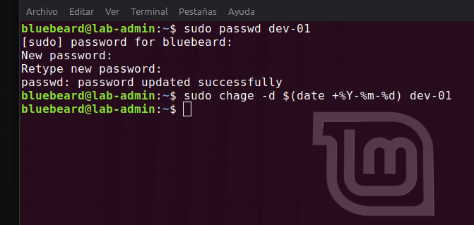
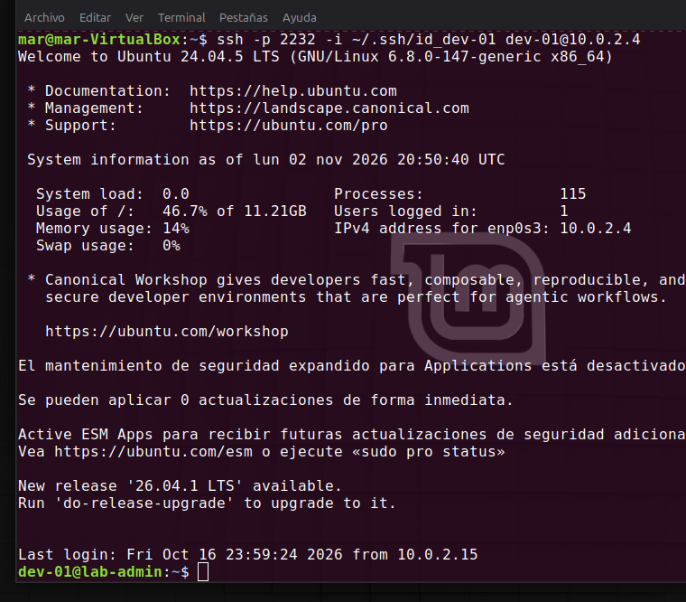

## 11. Lecciones Aprendidas y Conflictos de Políticas en Entornos de Producción (Troubleshooting)

Un hito crítico detectado durante este laboratorio ocurre al cruzar dos directivas de Hardening estrictas:
1. **Hardening de SSH:** Bloqueo total de autenticación por contraseñas (`PasswordAuthentication no`).
2. **Hardening de Usuarios:** Forzar expiración inmediata de la clave local (`chage -d 0`).

### El "Bucle de Bloqueo" Real
Al intentar un login remoto, el servidor valida exitosamente la llave criptográfica (Capa SSH), pero en el mismo milisegundo el Kernel interrumpe la sesión exigiendo un cambio de contraseña interactivo. Dado que el canal SSH tiene prohibido procesar contraseñas, la sesión se rompe y expulsa al usuario en un bucle sin salida.

### Mitigación en el Mundo Real (Resolución del Administrador)
Para resolver este escenario en producción sin degradar la seguridad del servidor ni comprometer credenciales en texto plano dentro del historial de la terminal (`~/.bash_history`), el Administrador del Sistema (`bluebeard`) debe intervenir de forma segura interactuando directamente con las políticas del Kernel:

```bash
# 1. Actualizar la credencial de forma interactiva y segura (ocultando caracteres)
sudo passwd dev-01

# 2. Forzar al sistema a registrar que el cambio se realizó el día de hoy, rompiendo el bucle
sudo chage -d \$(date +%Y-%m-%d) dev-01
```

<br>

<br>

### Verificación del Acceso Remoto Exitoso
Una vez restablecido el estado temporal de la cuenta por el administrador, el desarrollador vuelve a iniciar el intento de conexión desde el host cliente mediante su par de claves criptográficas:

```bash
ssh -p 2232 -i ~/.ssh/id_dev-01 dev-01@10.0.2.4
```

<br>

<br>

*Como se observa en la auditoría visual, el servicio SSH procesa la identidad criptográfica y concede acceso directo a la shell limpia sin intermediación de contraseñas ni interrupciones del Kernel.*

**Conclusión del Hardening:** En infraestructuras corporativas de gran escala, este conflicto demuestra por qué la gestión de identidades locales en cada servidor es reemplazada por soluciones centralizadas (como Active Directory o LDAP) o herramientas de gestión de configuración (como Ansible), evitando configuraciones interactivas sobre canales criptográficos restringidos.